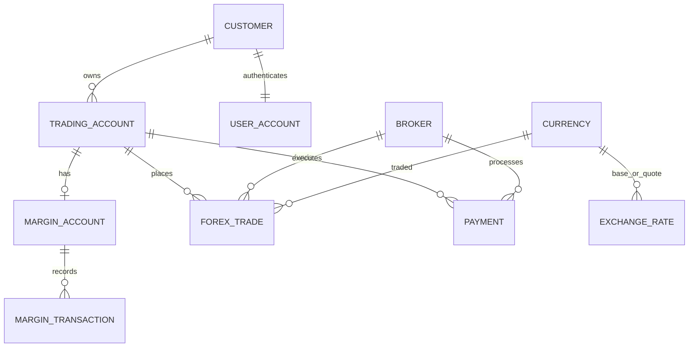

# Forex Trading System

A learning project built around the provided forex SQL: a Next.js web app, a MySQL relational database for accounts and trading operations, and a MongoDB collection for unstructured sample market notes.

> **Demo only:** balances and rates are simulated. No live market feed, payment provider, or real-money trading is connected. This is not financial advice.

## Requirements coverage

- Relational data: Customer, Broker, Currency, Exchange Rate, Forex Trade, Margin Account, Margin Transaction, Payment, Trading Account, and User Account.
- SQL concepts: DDL with keys/checks/enums, transactional stored procedures, indexed joins and aggregation, a summary view, and normalized currency references.
- NoSQL: MongoDB `market_insights` stores flexible sample insight documents, returned through an authenticated API.
- Next.js App Router UI and API routes use parameterized SQL statements and environment-sourced credentials.
- Authentication uses scrypt password hashes and signed, HTTP-only session cookies. Registration is `CUSTOMER`; `ADMIN` accounts are created only by the local bootstrap CLI. Admin reporting is role-protected.
- Setup and schema are documented here; the ER model is listed below.

## Local setup

Prerequisites: Node.js 20+, npm, and Docker Compose.

1. Copy `.env.example` to `.env.local` (`Copy-Item .env.example .env.local` in PowerShell). Replace the placeholder values for `DB_PASSWORD`, `MYSQL_ROOT_PASSWORD`, and `SESSION_SECRET` (at least 32 random characters). Do not commit the `.env.local` file.
2. Start the databases: `docker compose --env-file .env.local up -d`. The first MySQL start creates the schema and sample rows; MongoDB creates two synthetic insight documents.
3. Install and start the web app: `npm install`, then `npm run dev`.
4. Visit `http://localhost:3000` and register a customer account. It is created with a zero-balance trading and margin account.
5. To create an admin, run `node --env-file=.env.local scripts/create-admin.mjs`. It prompts for the administrator details and password; it does not accept a role through public registration.

The Compose setup maps MySQL to port `3308` and MongoDB to `27018` to avoid the common local MySQL port. The SQL file intentionally drops/recreates its objects and seed data; use only with a disposable development database. Compose initialization SQL runs only when the MySQL data volume is empty. To reinitialize that volume, use `docker compose down -v` only when you are certain its data can be deleted.

If sign-in reports that it cannot reach the API, confirm `npm run dev` is still running and open the same local URL printed by Next.js. If the API responds but reports an internal error, confirm Compose shows both databases healthy and that `.env.local` contains the matching database credentials and session secret. After changing environment values, restart the Next.js server.

For manual configuration, copy `.env.example` to `.env.local`, configure a MySQL 8 database and MongoDB 7 database, then execute `database/forex_trading_system.sql` against a fresh database. In PowerShell, import the schema with `Get-Content -Raw database\forex_trading_system.sql | mysql --host=127.0.0.1 --port=3308 --user=forex_app --password --default-character-set=utf8mb4`. Seed MongoDB sample documents with `npm run db:seed-insights`.

## ER model

`Exchange_Rate` has one row per ordered currency pair. `Forex_Trade` captures the execution rate at opening. `View_Customer_Trade_Summary` joins accounts, margin, and trades for account-level dashboard totals. MongoDB market notes are intentionally separate from this relational ER model.

## API surface

- `POST /api/auth/register`, `POST /api/auth/login`, `POST /api/auth/logout`, `GET /api/session`
- `GET /api/accounts`, `GET|POST /api/trades`, `POST /api/payments/deposit`
- `GET /api/insights` (authenticated, MongoDB-backed)
- `GET /api/admin/summary` (ADMIN only)

Trade and deposit changes run in MySQL stored procedures with validation, account locking, and transaction rollback. Public registration cannot create administrators. For production, add CSRF defenses, rate limiting, secure secret management, observability, a real payment integration, reviewed live market data, and migration tooling before deployment.
